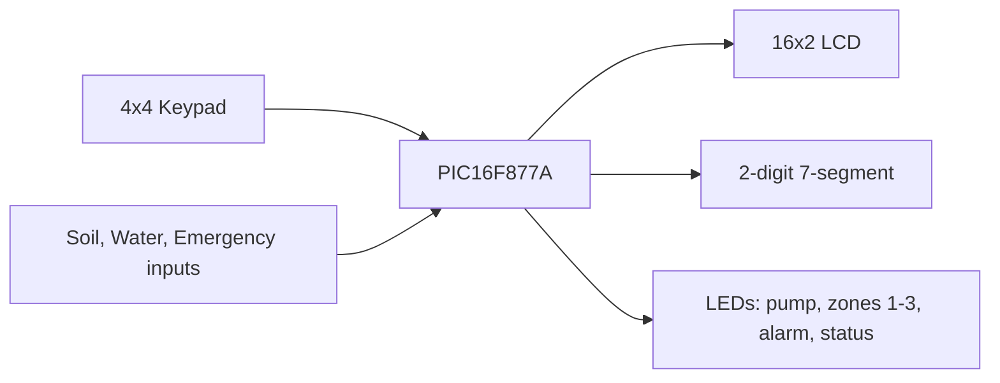
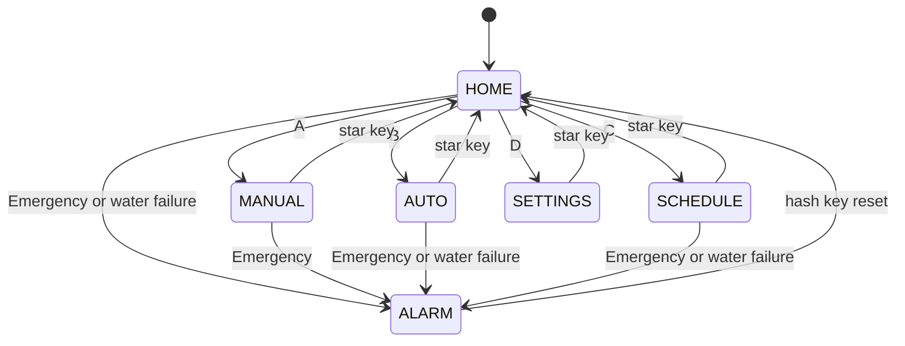
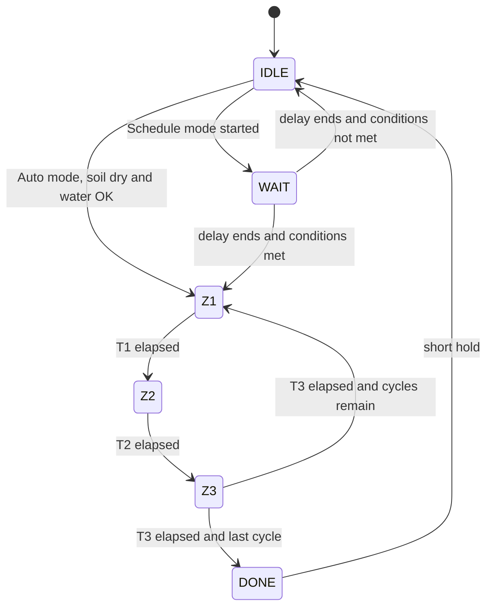

# Smart Irrigation System (PIC16F877A)

 -green) 

An embedded smart irrigation system built around the **PIC16F877A** microcontroller. It manages three irrigation zones through Manual, Auto, Schedule, and Settings modes, with a keypad and LCD user interface, a 7-segment countdown display, and a latched safety alarm. The firmware is written in C (MPLAB XC8) and verified in Proteus simulation.

---

##  Overview

Irrigating by hand wastes water and depends on someone being present. This system optimizes water use by irrigating only when the soil is dry and water is available, while still allowing manual control and scheduled runs. A safety layer stops everything immediately if an emergency occurs or the water supply fails.

##  Key Features

- **Four operating modes:** Manual, Auto, Schedule, and Settings.
- **Three irrigation zones:** run in sequence (Zone 1, Zone 2, Zone 3) and repeat for a set number of cycles.
- **Sensor-based irrigation:** Auto mode starts only when the soil is dry and water is available.
- **Configurable timing:** zone durations, number of cycles, and start delay can be changed from the keypad.
- **User interface:** 16x2 LCD for status and a dual 7-segment display for the countdown.
- **Safety system:** emergency stop, water-failure detection, error codes, and a latched alarm.
- **Interrupt-driven timing:** a Timer1 interrupt provides the time base and flicker-free display multiplexing.

##  System Architecture



##  Hardware Components

| Unit | Components |
|---|---|
| Processing | PIC16F877A microcontroller, 8 MHz crystal (HS mode) with 22 pF capacitors |
| Input | 4x4 keypad, three switches simulating soil dryness, water availability, and emergency stop |
| Display | LM016L 16x2 LCD (4-bit mode) with contrast potentiometer, 2-digit common-cathode 7-segment display (multiplexed) |
| Output | 6 LEDs: pump, three zones, alarm, and system status |

##  Pin Mapping

| Port | Function |
|---|---|
| **PORTA** | RA0: soil dryness sensor, RA1: water availability sensor, RA2: emergency switch, RA3 / RA5: 7-segment segments A / B |
| **PORTB** | 4x4 keypad: RB0 to RB3 columns (outputs), RB4 to RB7 rows (inputs with internal pull-ups) |
| **PORTC** | RC0: pump, RC1 to RC3: zones 1 to 3, RC4: alarm, RC5: status LED, RC6 / RC7: 7-segment segments F / G |
| **PORTD** | RD0: LCD RS, RD1: LCD E, RD4 to RD7: LCD D4 to D7, RD2 / RD3: 7-segment digit select |
| **PORTE** | RE0 to RE2: 7-segment segments C / D / E |


##  Operating Modes

The system is built as a **state machine**. After the startup message (`SMART FARM / READY`), the LCD shows the main menu:

```
A:MAN B:AUTO
C:SCH D:SET
```

| Mode | Key | Description |
|---|---|---|
| **Manual** | A | Select and run one zone directly, with no timer |
| **Auto** | B | Starts irrigation when the soil is dry **and** water is available |
| **Schedule** | C | Counts down a start delay, then irrigates if conditions are met |
| **Settings** | D | Sets zone durations, number of cycles, and start delay |
| **Alarm** | (automatic) | Entered on emergency or water failure |



### Keypad Controls

| Key (code) | Key on Proteus keypad | Function |
|---|---|---|
| `A` | ÷ | Manual mode |
| `B` | × | Auto mode |
| `C` | − | Schedule mode |
| `D` | + | Settings mode |
| `1` `2` `3` | 1 2 3 | Manual: turn on Zone 1 / 2 / 3 (one zone at a time) |
| `0` | 0 | Manual: all zones off |
| `1` to `5` | 1 to 5 | Settings menu: choose a parameter |
| `8` / `2` | 8 / 2 | Settings: increase / decrease the value |
| `*` | = | Back to home |
| `#` | ON/C | Save a setting, and reset the alarm |

### Settings Parameters

| Parameter | Menu key | Description | Default | Range |
|---|---|---|---|---|
| T1 | 1 | Zone 1 duration (seconds) | 10 | 1 to 99 |
| T2 | 2 | Zone 2 duration (seconds) | 8 | 1 to 99 |
| T3 | 3 | Zone 3 duration (seconds) | 6 | 1 to 99 |
| Cyc | 4 | Number of irrigation cycles | 2 | 1 to 9 |
| StartAfter | 5 | Start delay in Schedule mode (seconds) | 15 | 1 to 99 |

##  Irrigation Sequence

```
Zone 1 → Zone 2 → Zone 3 → repeat (according to Cyc)
```



| State | Description |
|---|---|
| IDLE | System inactive |
| WAIT | Counting down the start delay (Schedule mode) |
| Z1 / Z2 / Z3 | Irrigating the zone (pump and zone LED on) |
| DONE | Process completed, shown briefly before returning to IDLE |

The state machine ensures tasks never overlap. For example, no mode can start irrigation while the alarm is active.

##  Safety and Alarm System

The safety layer is checked on every program loop and has the highest priority:

- **Emergency switch (RA2):** shuts everything down immediately in any mode.
- **Water failure (RA1 low):** triggers the alarm if the water supply is lost while a scheduled wait or an irrigation run is active (Auto and Schedule), which prevents dry running.
- **Error codes** on the 7-segment display:

| Code | Meaning |
|---|---|
| `01` | Emergency stop |
| `02` | Water failure |

- **On alarm:** pump and zones turn off, the alarm LED turns on, the status LED blinks, and the LCD shows `!! ALARM !!` with the cause.
- **Latched alarm:** the system will not restart until it is reset manually with the `#` key. The emergency switch must be released first, otherwise the alarm triggers again.

##  Display

**LCD (16x2)** shows the current mode, active zone, remaining time, cycle progress, and state:

```
M:AUTO Z:2 T:07
C:1/2  RUN
```

| LCD text | Meaning |
|---|---|
| `M:MAN` / `M:AUTO` / `M:SCH` | Current mode |
| `Z:n` | Active zone (0 when none) |
| `T:nn` or `WT nn` | Remaining time, or the start-delay countdown |
| `C:x/y` | Current cycle out of total cycles |
| `IDLE` / `READY` / `RUN` / `DONE` | System state |

**7-segment display (2 digits):** shows the countdown in seconds, or the alarm code when an alarm is active.

##  Software Architecture

The firmware is modular, in four layers:

| Layer | Responsibility |
|---|---|
| Input | Reads the keypad, sensors, and emergency switch |
| Decision | The "brain": selects the mode and manages state transitions |
| Execution | Activates the pump, opens zone valves, starts timers |
| Display | Updates the LCD and 7-segment display with status and countdown |

**Key techniques**

- **Keypad scanning:** one column is driven LOW at a time and the rows are read, which minimizes the number of pins. The pressed key is identified by the row and column intersection.
- **Debouncing:** a 20 ms confirmation delay and press-edge detection prevent one press from being counted multiple times.
- **Timer1 interrupt:** with an 8 MHz crystal, a 1:8 prescaler, and a preload of `0xF63C`, Timer1 fires every **10 ms**. The interrupt multiplexes the two 7-segment digits (each refreshed at 50 Hz), toggles the blink flag, and counts 100 ticks to produce the 1-second time base, with no blocking software delays in the control logic.
- **Microcontroller configuration:**

```c
#pragma config FOSC = HS     // High-speed crystal
#pragma config WDTE = OFF    // Watchdog disabled
#pragma config PWRTE = ON    // Power-up timer enabled
#pragma config BOREN = ON    // Brown-out reset enabled
#pragma config LVP = OFF     // Low-voltage programming disabled
#define _XTAL_FREQ 8000000   // 8 MHz
```

##  How to Run

1. Install **Proteus 8.6 SP2 Professional** and **MPLAB X IDE v6.20** with the **XC8 compiler**.
2. Open the Proteus project `Simulation/Smart-Farm.pdsprj`.
3. Double-click the PIC16F877A, set the **Program File** to the compiled `Smart-Farm.hex`, and set the **clock frequency to 8 MHz**.
4. Start the simulation and use the keypad and switches to test each mode.
5. To rebuild the firmware, create an MPLAB X project for the PIC16F877A, add `newfile.c`, and build it with XC8.

### Quick Test

1. After power-up, the LCD shows `SMART FARM / READY`, then the main menu.
2. Press `B` (Auto), then turn **soil dry** and **water OK** switches ON. Zones 1, 2, and 3 irrigate in sequence and the 7-segment display counts down.
3. Turn the **water** switch OFF while irrigating. The alarm starts with code `02`.
4. Press `#` to reset. Then try the **emergency** switch for code `01` (release it before pressing `#`).
5. Press `D` to change zone times and cycles, then run Auto again.

##  Simulation Results

Proteus simulation confirmed that:

- The system responds immediately to commands.
- Timing is accurate thanks to the Timer1 interrupt.
- Wiring and real-time sensor response behave as designed.

##  Behavior Notes

- Settings are kept in RAM, so they return to their defaults after a power cycle.
- In Auto mode, irrigation restarts as long as the soil stays dry and water is available.
- In Schedule mode, if the soil is not dry when the delay ends, the run ends without irrigating.
- Manual mode has no timer: the selected zone stays on until it is turned off or the alarm triggers.

##  Possible Improvements

- Save settings in the internal EEPROM so they survive power loss.
- Monitor water availability in Manual mode as well.
- Replace the soil switch with an analog moisture sensor read through the ADC.
- Add a real-time clock for daily schedules.
- Add remote monitoring (GSM or IoT).

##  Repository Structure

```
├── Code/
│   └── newfile.c                   # Firmware source (MPLAB XC8)
├── Simulation/
│   └── Smart-Farm.pdsprj        # Proteus project
├── Documentation/
│   └── smart farm.pdf           # Full project report
├── Images/
│   └── Circuit.png              # Circuit schematic
└── README.md
```

##  Skills Demonstrated

- Embedded C programming for PIC microcontrollers
- State machine design
- Interrupt-driven timing (Timer1)
- Keypad scanning, debouncing, and display multiplexing
- Sensor interfacing and safety system design
- Circuit simulation with Proteus
